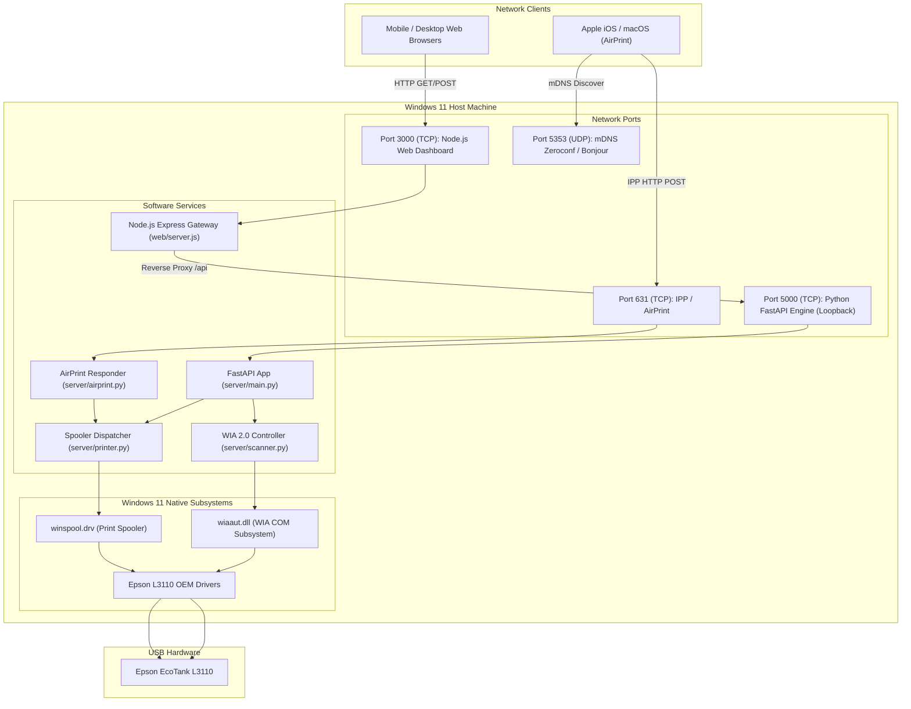
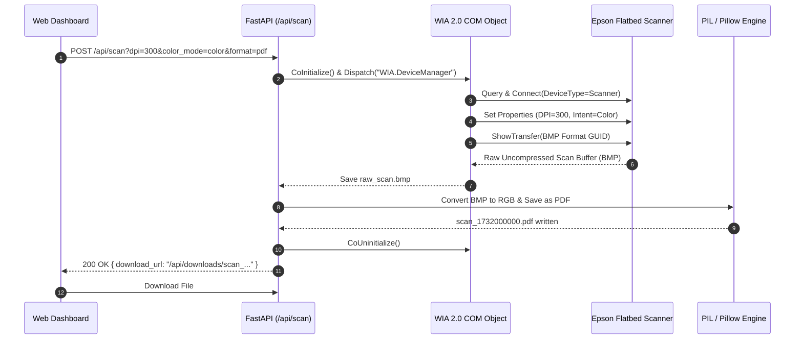

# Technical Architecture & Contextual Specifications

This document outlines the internal mechanics, communication flows, and subsystem integrations of the **Epson L3110 All-in-One Print & Scan Server** running on Windows 11.

---

## 1. System Context & Decomposition

---

## 2. Inbound Protocols & Discovery

### 2.1 Apple AirPrint (IPP 2.0 & mDNS)
Apple devices (iPhone, iPad, Mac) look for printers on the local Wi-Fi subnet using **DNS Service Discovery (DNS-SD)** over multicast DNS (mDNS) port `5353`.

- **Service Type**: `_ipp._tcp.local.` and `_universal._sub._ipp._tcp.local.`
- **Required TXT Record Attributes**:
  - `txtvers=1`: DNS-SD TXT version.
  - `qtotal=1`: Number of queues.
  - `rp=printers/epson`: Resource path for HTTP requests.
  - `ty=Epson L3110 Series`: Friendly display name in the iOS picker.
  - `pdl=application/pdf,image/urf,image/jpeg`: Accepted Page Description Languages.
  - `Color=T`: Color printing capability flag.
  - `Duplex=F`: Manual duplex only.
  - `URF=W8,SRGB24,CP1,RS300`: Universal Raster Format capabilities.

When an iOS client selects the printer and taps "Print", it sends an HTTP POST request to `http://<windows-host-ip>:631/printers/epson` containing an IPP binary payload with the document stream. The `server/airprint.py` parser intercepts the payload, extracts the document stream into `temp/spool/`, and dispatches it into the Windows Spooler.

---

## 3. Subsystem Lifecycle & Operations

### 3.1 Scanner Pipeline (WIA 2.0 COM)
The scanner pipeline avoids third-party scanning binaries by communicating directly with the Windows WIA COM server (`WIA.DeviceManager` / `WIA.CommonDialog` in `wiaaut.dll`).

### 3.2 Print Spooler Dispatcher
The printer dispatcher relies on the Windows Print Spooler service (`spoolsv.exe`). When a print job is submitted:
1. The uploaded file is saved to the local spool directory `temp/spool/`.
2. `server/printer.py` attempts a `win32api.ShellExecute(0, "printto", filepath, f'"{target_printer}"', ".", 0)`.
3. Windows routes the document through the registered handler and into the Epson OEM driver.
4. The Epson driver converts the pages into Epson ESC/P-R raster packets and streams them over the USB interface.

---

## 4. Security & Network Considerations

- **Binding Strategy**:
  - The Python FastAPI service binds to `0.0.0.0:5000` or loopback `127.0.0.1:5000`.
  - The Node.js Express server binds to `0.0.0.0:3000` to serve devices on the local Wi-Fi.
  - The AirPrint IPP listener binds to `0.0.0.0:631`.
- **Firewall Exceptions**:
  - Inbound TCP 3000 (Web Dashboard)
  - Inbound TCP 631 (AirPrint IPP)
  - Inbound UDP 5353 (mDNS Discovery)
